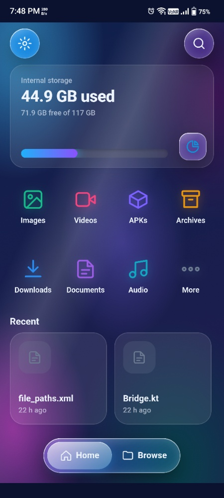
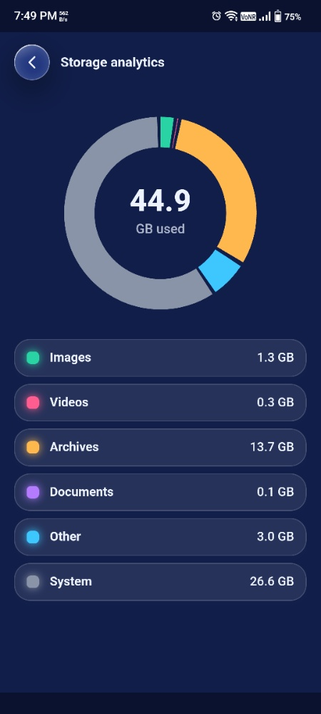
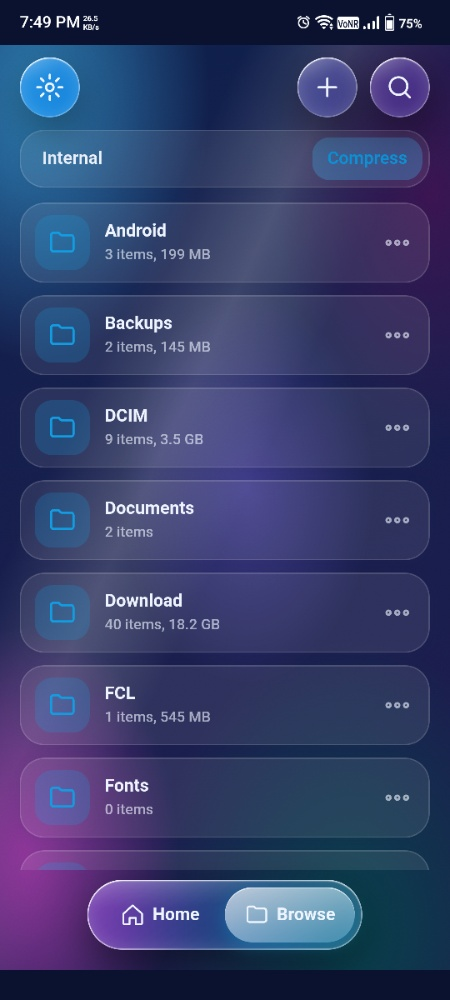

<div align="center">
  
  <h1>Glimpse</h1>
  <p>A liquid-glass file manager for Android, written entirely in Kotlin with Jetpack Compose.</p>
</div>

## Screenshots

| Home | Storage Analytics | Browse |
| :---: | :---: | :---: |
|  |  |  |

## Features
- Liquid-glass navigation pill and buttons over a gradient wallpaper
- Home with storage card, category shortcuts and a Recents carousel
- Browse with breadcrumbs, list and grid views, thumbnails, long-press multi-select, copy, move, rename, share and delete to the Recycle Bin
- Create new folders and files
- Search across your storage
- Storage analytics with an interactive donut chart
- Recycle Bin with restore and permanent delete
- ZIP: inspect, create and extract
- Built-in FTP server
- Settings for theme, accent colour, hidden files, sort order and Recycle Bin schedule

## Build the APK
**With GitHub Actions:**
1. Push this repo to GitHub.
2. Open the **Actions** tab, choose **Build APK**, then **Run workflow**.
3. Download `Glimpse-apk` from the finished run, or take `Glimpse.apk` from the latest **Release**.
4. Install it and grant **All files access** when Android asks.

**With Android Studio:** open the `android/` folder and run the `app` configuration.

## Requirements
- Android 8.0 (API 26) or newer
- JDK 17 and Gradle 8.7 (the workflow sets both up)
- Stack: Kotlin 1.9.24, Jetpack Compose (BOM 2024.06.00), Material 3, Apache FtpServer

## Notes
- Android 11 and newer block `Android/data` and `Android/obb`, even with all-files access.
- Google Play only allows `MANAGE_EXTERNAL_STORAGE` for apps that qualify as file managers. Sideloading is unaffected.

## Structure
```
android/
  app/src/main/java/com/glimpse/files/
    MainActivity.kt        entry point and permission flow
    data/                  file access, models, FTP, ZIP
    ui/                    Compose screens, theme and view model
icons/                     app icon, 512 / 192 / 108 px
screenshots/               images used in this README
.github/workflows/         APK build and release workflow
```

## License
See [LICENSE](LICENSE).
